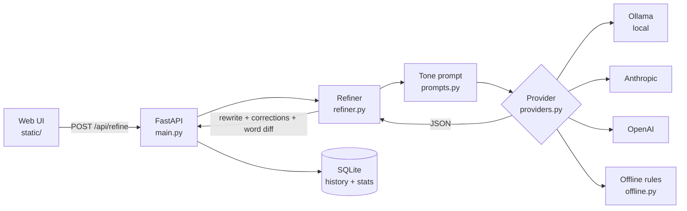

# SecondLang

**Refine your English for the person you're writing to.**

SecondLang rewrites your phrases in correct, natural English in one of two tones: **Formal** (teachers, office, HR) or **Family** (parents, siblings, relatives). It explains every correction so you learn from your mistakes, and it keeps track of the mistakes you make most.


<!--
TODO before publishing:
  1. Record a demo GIF to docs/demo.gif, then uncomment the <p> block below.
  2. When deployed, add:  > 🔗 **Live demo:** https://...
-->
<!--
<p align="center">
  
</p>
-->

---

## Why I built this

English is my second language. I write in two very different situations: formal messages (leave applications, emails to professors, HR) and casual messages to family, often mixed with Hindi. Grammar checkers fix spelling, but they miss **tone** and don't explain *why* something is wrong. SecondLang does both, and shows me which mistakes I repeat so I can actually improve.

## Examples

### Formal

**Input:**
```
sir i want leave tmrw coz my cousin marriage
```

**Output:**
```
Dear Sir, I would like to request leave tomorrow, as I need to attend my cousin's wedding.
```

| Mistake | Fix | Why |
|---|---|---|
| `tmrw`, `coz` | `tomorrow`, `as` | Text-speak isn't suitable for formal writing |
| `i want leave` | `I would like to request leave` | "Want" sounds demanding; "would like to request" is polite |
| `cousin marriage` | `cousin's wedding` | Possessive needs `'s`; "wedding" is the event, "marriage" is the relationship |

### Family (with Hinglish)

**Input:**
```
mummy i will come late today, dont make khana for me
```

**Output:**
```
Mummy, I'll be home late today, so please don't cook for me.
```

| Mistake | Fix | Why |
|---|---|---|
| `mummy` | `Mummy` | Capitalise a family name when you address someone directly. "Mummy" is kept, not translated |
| `dont` | `don't` | Contractions need an apostrophe |
| `make khana` | `cook` | Hindi words are translated into natural English |
| `come late` | `be home late` | Sounds more natural for a message to family |

## Features

- **Two tones:** Formal and Family, each with its own rules
- **Word-by-word diff:** red = removed, green = added
- **Explained corrections:** a short reason for every change
- **Personal tip:** based on your biggest mistake in that phrase
- **Hinglish support:** Hindi words are translated, except family words like *Mummy, Papa, Bhaiya, Didi* in Family mode
- **History and stats:** every refinement is saved locally, with a chart of your most common mistake types
- **Choose your engine:** a local model (Ollama), Anthropic, OpenAI, or an offline rule-based mode that needs no AI at all

## How it works



1. The UI sends your text and tone to `/api/refine`.
2. `prompts.py` builds a tone-specific prompt that asks the model for a structured JSON answer.
3. The selected provider returns the rewrite, the corrections and a tip.
4. `refiner.py` parses the JSON and computes the word-level diff.
5. The result is saved in SQLite, and the mistake types feed the stats chart.

## Design decisions

- **The diff is computed in Python, not by the model.** LLMs are unreliable at reporting exactly which words they changed. Comparing the input and output deterministically means the red/green highlighting is always accurate.
- **Structured JSON output.** Asking for a fixed shape (rewrite, corrections, tip) lets the UI render a table and lets the app count mistake types for the stats chart.
- **Pluggable providers.** All engines sit behind one interface in `providers.py`, so switching between a free local model and a paid API is a one-line change in `.env`.
- **An offline fallback.** The rule-based mode lets anyone run and test the app with no GPU, no API key and no internet.
- **Local-first storage.** History lives in a SQLite file on your own machine; there is no account and no server-side database.

## Tech stack

| Layer | Tools |
|---|---|
| Backend | Python, FastAPI, Pydantic, SQLite |
| Frontend | HTML, CSS, vanilla JavaScript |
| AI engines | Ollama (Qwen 2.5 7B), Anthropic API, OpenAI API, rule-based fallback |
| Testing | pytest |

## Project structure

```
secondlang/
├── app/
│   ├── main.py        # FastAPI app: /api routes + serves the web page
│   ├── config.py      # settings from .env
│   ├── prompts.py     # tone definitions + the prompt sent to the model
│   ├── providers.py   # Ollama / Anthropic / OpenAI / offline backends
│   ├── refiner.py     # calls the model, parses JSON, builds the word diff
│   ├── offline.py     # rule-based fallback (no AI needed)
│   ├── db.py          # SQLite history + mistake stats
│   ├── schemas.py     # request/response models
│   └── __main__.py    # `python -m app` starts the server
├── static/            # web interface (index.html, style.css, app.js)
├── tests/             # pytest tests
├── docs/              # screenshots / demo GIF
├── requirements.txt
└── .env.example
```

## Getting started

**Prerequisites:** Python 3.10 or newer.

### 1. Install

```bash
git clone https://github.com/shekharsanskar9/secondlang.git
cd secondlang
python3 -m venv .venv
source .venv/bin/activate          # Windows: .venv\Scripts\activate
pip install -r requirements.txt
cp .env.example .env               # Windows: copy .env.example .env
```

### 2. Choose an engine

Set `LLM_PROVIDER` in `.env`:

| Provider    | Cost | What you need |
|-------------|------|---------------|
| `offline`   | Free, no AI | Nothing. Fixes only common mistakes (spelling, text-speak, apostrophes, capitals) |
| `ollama`    | Free, runs on your computer | Install [Ollama](https://ollama.com), run `ollama pull qwen2.5:7b`, and keep Ollama running |
| `anthropic` | Paid API | `ANTHROPIC_API_KEY` |
| `openai`    | Paid API | `OPENAI_API_KEY` |

**Tip:** start with `LLM_PROVIDER=offline` to check that everything runs, then switch to a model.

### 3. Run

```bash
python -m app
```

Open **http://127.0.0.1:8000**, type a phrase, pick a tone and press **Ctrl + Enter** (**⌘ + Enter** on Mac).
Interactive API docs (Swagger) are at **http://127.0.0.1:8000/docs**.

## API

| Method | Path | Description |
|--------|------|-------------|
| `POST` | `/api/refine` | Refine a phrase (body below) |
| `GET` | `/api/history?limit=50` | Past refinements, newest first |
| `DELETE` | `/api/history/{id}` | Delete one item |
| `DELETE` | `/api/history` | Clear all history |
| `GET` | `/api/stats` | Count of mistakes by type |
| `GET` | `/api/tones` | Available tones |
| `GET` | `/api/health` | Active provider and model |

`POST /api/refine` body:

| Field | Type | Required | Notes |
|---|---|---|---|
| `text` | string | yes | The phrase to refine |
| `tone` | `"formal"` \| `"family"` | yes | |
| `context` | string | no | Extra context, e.g. who you're writing to |
| `save` | bool | no | Save to history (default `true`) |

Example:

```bash
curl -X POST http://127.0.0.1:8000/api/refine \
  -H "Content-Type: application/json" \
  -d '{"text": "sir i want leave tmrw coz my cousin marriage", "tone": "formal"}'
```

## Tests

```bash
pytest -q
```

## Adding a new tone

1. Add an entry to `TONES` in `app/prompts.py` (for example `"friends"` or `"customer"`).
2. Add a button in `static/index.html` with the same `data-tone` value.

Nothing else needs to change.

## Limitations

- The offline mode only catches common, pattern-based mistakes; it can't fix tone or sentence structure.
- The model's JSON isn't validated or retried yet, so a malformed response from a small local model can fail the request (see Roadmap).
- History is designed for a single local user; there are no accounts.

## Roadmap

**Next**
- [ ] Validate model JSON with Pydantic and retry once if it's malformed
- [ ] Evaluation set of real phrases to compare engines and catch prompt regressions
- [ ] Docker + GitHub Actions CI
- [ ] Deploy a public demo

**Learning features**
- [ ] Practice mode: quiz yourself on your past mistakes
- [ ] Progress chart: mistakes per 100 words over time
- [ ] Explanations in Hindi/Hinglish (toggle)

**More ways to write**
- [ ] More tones: Friends, Professor, Interview/HR email
- [ ] Templates: leave application, email to professor, interview follow-up
- [ ] Streaming responses
- [ ] Voice input (speech-to-text) and read-aloud (text-to-speech)

## Privacy

History is stored only in a local SQLite file on your machine.
With `ollama` or `offline`, your text never leaves your computer. With `anthropic` or `openai`, the text you refine is sent to that provider's API.

## License

MIT. See [LICENSE](LICENSE).

## Author

**Sanskar Shekhar**, B.Tech CSE, BIT Mesra
[GitHub](https://github.com/shekharsanskar9) · [LinkedIn](https://linkedin.com/in/sanskar-shekhar)
